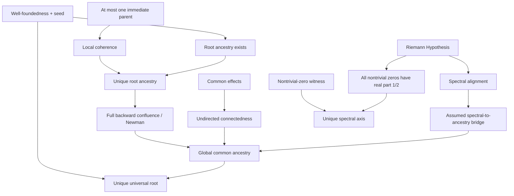

# Audit of the Neoplatonic–Avicennian Lean experiment

Date: 12 October 2026, Asia/Singapore.

The source archive contains ten Lean modules, three Python scripts, a
README, and a shell verification script. Its SHA256 is
`cdc585af502adbe7b03d1e93a44e806a6933dc9a1552cea5ed986dd8a89cc468`.
The archive was preserved and extracted separately before editing. The
delivered project includes repaired original modules and structural
extensions. `RESEARCH.md` explains the mathematical and philosophical
findings in detail.

## Acceptance evidence and scope

**Result: PASS — 17 modules, 81 theorem declarations.** Every module was
built and independently re-elaborated; every theorem passed the transitive
axiom gate, and all four Python audits exited successfully.

The acceptance gate is `python verify.py`. Its result, exact Lean version,
Mathlib revision, theorem count, per-theorem axiom dependencies, and source
SHA256 values are recorded in `verification/summary.json`. Each module
has an independent elaboration log. `verification/axioms.log` contains
Lean's elaborated types and `#print axioms` output for every theorem.
Do not infer verification from the absence of placeholder text alone.

The environment is pinned to Lean **4.24.0**, compiler commit
`797c613eb9b6d4ec95db23e3e00af9ac6657f24b`, and Mathlib commit
`f897ebcf72cd16f89ab4577d0c826cd14afaafc7` (tag `v4.24.0`). All eight
transitive package revisions are fixed in `lake-manifest.json`.
The Windows Lean archive SHA256 is
`c2fcf1cba1089e526e184de2a6f6763a6e15596a2991f096dfacd4a6e3ce2cdd`.

This gate checks the project with Lean's elaborator and kernel. Standard
Mathlib dependencies are loaded from the official cache corresponding
to the pinned sources; the entire Mathlib library has not been rebuilt
or independently kernel-replayed from source in this session. The trust
boundary includes Lean's implementation, standard logical axioms, and
the official dependency artifacts. No external finite checker is used
to discharge a Lean theorem.

The source gate rejects proof escapes (`sorry`, `admit`, extra `axiom`
declarations, `unsafe`, `native_decide`, and implementation replacement).
The transitive axiom gate allows only Lean's standard `propext`,
`Classical.choice`, and `Quot.sound`. These foundational commitments
are not metaphysical grounding premises. The latter are explicit
arguments or fields in the theorem types. RH is likewise an argument,
not a global axiom. `#print axioms` alone would not display such
arguments, which is why the theorem types and field inventory matter.

The CI workflow and Windows bootstrap are provided for reproduction.
The local acceptance gate is the execution evidence; no claim is made
that a GitHub Actions run or a second-platform bootstrap has occurred.

## Repairs to the exploratory code

1. All ten original files put a `/-! ... -/` module-documentation command
   before `import`. Lean rejects that layout. Imports now precede module
   documentation.
2. `Core.unique_first_principle` concluded `root = y` where `ExistsUnique`
   requires `y = root`; the equality is now reversed.
3. Several `Reach` case patterns supplied too many arguments: the source
   endpoint is a fixed parameter of the generated recursor. The `refl`
   and `step` patterns in Core, Amalgamation and LocalConfluence were
   corrected to the actual recursor signatures.
4. The local-coherence hypothesis binder was renamed from the reserved
   syntax word `local` to `lc`.
5. Broad `import Mathlib` was replaced with explicit imports. The genuine
   zeta/RH module is imported directly in `RH.lean`.
6. A Lake project, aggregate module, pinned dependency manifest, axiom
   gate, and independent model-check gate replace the original ad hoc
   `verify.sh`. Merely running `lake env lean` on source files without
   generating imported `.olean` files is insufficient in a fresh project.

Original mathematical statements and structure fields were preserved.
The extensions establish stronger statements and expose equivalent
premises rather than add hidden axioms.

## Substantive premise inventory

| Structure / theorem | Explicit commitments | Consequence |
|---|---|---|
| `GroundTheory` + seed | well-founded `prior`; pairwise common ancestors; nonempty carrier | unique universal root |
| `LinearGroundTheory` + seed | well-founded `prior`; total immediate comparability | common ancestry, hence unique universal root |
| `AmalgamatedGroundTheory` + seed | well-founded; common effects; at most one immediate parent | common ancestry, hence unique universal root |
| `ConfluentGroundTheory` + seed | well-founded; common effects; common ancestors for immediate co-grounds | common ancestry, hence unique universal root |
| `connected_unique_first_principle` | well-founded; local coherence; undirected connectedness; seed | unique universal root |
| `meet_well_founded_first_principle` | meet-semilattice; well-founded strict order; seed | least element / universal root for `<` |
| `order_bot_first_principle` | partial order with a supplied bottom | universal root for `<` |
| `complete_lattice_first_principle` | complete lattice, including its bottom | universal root for `<` |
| `compact_lower_directed_first_principle` | nonempty compact space; partial order; closed principal lower sets; common lower bounds | least element / universal root for `<` |
| `grounding_first_principle_iff_initial` | well-founded grounding, with its reachability order | target equivalent to initiality in the associated thin category |
| `RHGroundTheory` + RH | well-founded; natural realization map with injectivity; spectral alignment implies common ancestry | unique universal root |
| `rh_unique_spectral_axis` | RH; existence of a nontrivial zero | unique shared real coordinate `1/2` |

The realization map in `RHGroundTheory` supplies a seed at `0`.
Its injectivity field is unused by the proof. There is no derivation of
common ancestry from injectivity, arithmetic infinitude, or RH alone.

## Circularity and orientation findings

Write `a ≺ b` for a grounding edge and `a ≼ b` for `Reach prior a b`.
Well-foundedness prevents infinite descent **toward grounds**, not
infinite growth toward consequences. It already excludes directed cycles,
and the extension proves antisymmetry of `≼`. There is no need to add
antisymmetry as an independent premise.

With well-foundedness and a seed, the following are equivalent:

- pairwise common ancestry;
- local coherence plus undirected connectedness;
- existence of exactly one root;
- existence of a unique ungrounded ancestor of every object.

Under well-foundedness, local coherence alone is equivalent to each
individual object having exactly one root ancestor. It permits different
roots in different components. It prevents their histories from merging.
Common effects is a stronger global connectivity assumption than the
new theorem needs. The reverse fork is a kernel-verified counterexample
to connectedness implying common effects.

These equivalences do not make every argument using them formally
circular. They show exactly which premises need independent support.
The original Core theorem cannot serve as an independent derivation of
unity if its common-ancestry premise is defended only by the desired unity.
The RH bridge is subject to the same objection.

The displayed conjecture in the request omits nonemptiness and is false
on `Empty`. `empty_domain_counterexample` verifies all its structural
premises and the failure of its existential conclusion. The original
code's seed parameter already avoids this error. With a seed the
conjecture is valid, and connectedness can replace common effects.

For rewriting, use `effect → ground`, the converse of `prior`. Then
well-founded grounding is termination, roots are normal forms, and local
coherence is local confluence. `backward_newman` proves full confluence;
`newman_rewriting` expresses the result in Mathlib's closure/join API.
No orientation reversal is suppressed. Details appear in `RESEARCH.md`.

## Independent finite-model audit

All three original scripts were inspected and executed. They enumerate
all `2^(n(n-1))` labeled loopless directed relations for `1 ≤ n ≤ 4`,
compute reflexive-transitive closure by Floyd–Warshall, and discard graphs
with an edge participating in a directed cycle. In finite graphs this
is exactly well-foundedness. Graphs are labeled, not isomorphism classes;
multiple topological orders do not cause double counting.

`audit_independent.py` instead enumerates **all** directed relations,
including loops, for `0 ≤ n ≤ 4`: 66,067 relations in total. It uses
Kahn's algorithm for acyclicity and per-source DFS for reachability,
cross-checking the original closure matrix on every DAG. It independently
recomputes all original counts, checks the characterization theorems in
all nonempty cases, and asserts agreement. The labeled-DAG
inclusion-exclusion recurrence independently gives `1,1,3,25,543`.

| n | DAGs | common ancestors | common effects | local coherence | local + effects | multiple parents among local + effects | local + connected |
|---:|---:|---:|---:|---:|---:|---:|---:|
| 1 | 1 | 1 | 1 | 1 | 1 | 0 | 1 |
| 2 | 3 | 2 | 2 | 3 | 2 | 0 | 2 |
| 3 | 25 | 15 | 15 | 22 | 12 | 6 | 15 |
| 4 | 543 | 316 | 316 | 401 | 216 | 192 | 316 |

For common effects plus at most one parent, the accepted counts are
`1,2,6,24`; for at most one parent alone they are `1,3,16,125`.
Every tested nonempty implication has zero counterexamples.
The empty carrier satisfies the universal premises vacuously but has
no existential witness. The checker records that exceptional case.

Two labeling cautions matter:

- `audit_models.py` calls global common ancestry `coherent`; this is
  stronger than the local coherence in `audit_confluence.py`.
- `branching_and_merging` in the original checker only tests whether some
  node has multiple parents. It is not a separate test for two distinct
  paths that branch and rejoin, or for irredundant immediate edges.

The original **543 / 216 / 192** README claim is numerically correct
for its definition of a DAG. If "immediate" means a cover relation, the
four-node counts instead are **219** cover DAGs, **36** satisfying local
coherence plus common effects, and **12** of those allowing multiple
parents. At three nodes the cover counts are 19, 6, and 0.
`DiamondModel.lean` verifies a four-node branching/merging cover model.
Thus the phenomenon survives the immediacy requirement, but the original
three-node triangle is not a cover example.

Enumeration is evidence against small counterexamples, not a proof for
infinite domains or even for untested finite sizes. The original scripts
only print counterexample counts; the new independent gate asserts the
expected equalities and exits with failure on disagreement.

## README claims and epistemic classification

| Original claim | Audit finding |
|---|---|
| Scripts contain no placeholder proofs or theorem-level axioms | Source-text claim was correct; it did not imply compilability. |
| Kernel verification was unavailable in the original session | Correctly disclosed. The supplied source was uncompiled and contained actual errors. |
| Core unity from well-foundedness and common ancestry | Correct conditional theorem after repairs; common ancestry is equivalent to the target in this setting. |
| Unity from common effects and unique direct parent | Correct conditional theorem; the single-parent premise is restrictive. |
| Unity from well-foundedness, local coherence and common effects | Correct with a nonempty carrier; now strengthened to connectedness. |
| Branching and merging are permitted | Correct for arbitrary grounding graphs; a genuine cover example requires four nodes, supplied here. |
| Symmetry obstructs a unique invariant integer | Correct; the fixed-witness lemma needs only a predicate-preserving self-map, not a bijection. |
| RH aligns the real parts of nontrivial zeros | Correct for genuine Mathlib RH. |
| RH plus a zero witness uniquely characterizes the spectral coordinate | Correct conditional mathematics; it selects a real coordinate, not an ontological object. |
| Spectral-to-ontology bridge is unjustified | Correct; it supplies the common ancestry needed by Core. |
| A universal root resembles an initial object | Exact in the thin reachability category; arbitrary categories have uniqueness only up to isomorphism. |
| Modal necessity differs from grounding independence | The toy model establishes that distinction for its explicit all-worlds existence interpretation; it is not a formalization of Gödel's or Avicenna's full systems. |
| Finite audit counts | Correct with the graph and labeling qualifications above. |
| No divine attributes or physical instantiation follow | Correct. No theorem in this project bridges from the abstract model to actual reality. |

The mathematical theorems are ordinary implications or concrete model
facts. The grounding structure fields are additional premises if a model
of reality is proposed. Calling the resulting root "the One", "necessary
through itself", or "God" is a philosophical interpretation not supplied
by a theorem. No argument here establishes consciousness or a personal deity.

## Dependency map



The arrow from single-parent to local coherence is mathematically direct
(equal parents have themselves as common ancestor); the original
Amalgamation implementation proves root agreement directly. The arrow
through the RH bridge is explicitly an **assumption**, not an analytic
derivation.

Imports follow these principal paths:

- Core → Amalgamation → LocalConfluence → Structure → Orders.
- Core → RH → RHGeometry → RHIndependence, with Models also imported.
- Amalgamation → MergeModel; LocalConfluence → CoherentModel.
- Structure → DiamondModel; Orders + MergeModel + Models → Counterexamples.
- Orders → Compactness and Category.
- Core → Symmetry, Models, Modal. `Neoplatonic.lean` imports every module.

## Complete theorem inventory

The following appendix is generated from all delivered Lean modules.
Every theorem appears with its full source signature and module. These
signatures expose the explicit hypotheses; the elaborated versions and
actual axiom dependencies are in `verification/axioms.log`. Definitions,
model carriers, and theory fields are audited in the tables above and
remain readable directly in the source.

81 theorem declarations across 17 modules.

### Amalgamation.lean (3 theorems)

```lean
theorem exists_root_ancestor {α : Type u}
    (prior : α → α → Prop) (wf : WellFounded prior) (x : α) :
    ∃ r : α, Root prior r ∧ Reach prior r x
```

```lean
theorem root_ancestors_agree {α : Type u}
    {prior : α → α → Prop}
    (singleParent : ∀ (x y z : α), prior x z → prior y z → x = y)
    {r z : α} (hr : Root prior r) (hrz : Reach prior r z) :
    ∀ s : α, Root prior s → Reach prior s z → r = s
```

```lean
theorem amalgamation_unique_first_principle {α : Type u}
    (theory : AmalgamatedGroundTheory α) (seed : α) :
    ∃! g : α, FirstPrinciple theory.prior g
```

### Category.lean (3 theorems)

```lean
theorem least_iff_initial {α : Type u} [PartialOrder α] (g : α) :
    (∀ x : α, g ≤ x) ↔ Nonempty (CategoryTheory.Limits.IsInitial g)
```

```lean
theorem first_principle_iff_initial {α : Type u} [PartialOrder α] (g : α) :
    FirstPrinciple (fun a b : α => a < b) g ↔
    Nonempty (CategoryTheory.Limits.IsInitial g)
```

```lean
theorem grounding_first_principle_iff_initial {α : Type u}
    (r : α → α → Prop) (wf : WellFounded r) (g : α) :
    letI : PartialOrder α
```

### CoherentModel.lean (5 theorems)

```lean
theorem coherent_well_founded : WellFounded CoherentPrior
```

```lean
theorem origin_reaches (x : CoherentNode) :
    Reach CoherentPrior .origin x
```

```lean
theorem every_node_reaches_apex (x : CoherentNode) :
    Reach CoherentPrior x .apex
```

```lean
theorem coherent_unique_first_principle :
    ∃! g : CoherentNode, FirstPrinciple CoherentPrior g
```

```lean
theorem coherent_allows_multiple_parents :
    CoherentPrior .origin .apex ∧ CoherentPrior .branch .apex
```

### Compactness.lean (1 theorems)

```lean
theorem compact_lower_directed_first_principle {α : Type u}
    [PartialOrder α] [TopologicalSpace α] [CompactSpace α] [Nonempty α]
    (lowerDirected : ∀ x y : α, ∃ z, z ≤ x ∧ z ≤ y)
    (closedLower : ∀ x : α, IsClosed (Set.Iic x)) :
    ∃! g : α, FirstPrinciple (fun a b => a < b) g
```

### Core.lean (8 theorems)

```lean
theorem ancestor_of_root_eq {α : Type u}
    {prior : α → α → Prop} {x y : α}
    (hy : Root prior y) (h : Reach prior x y) : x = y
```

```lean
theorem exists_root {α : Type u}
    (prior : α → α → Prop) (wf : WellFounded prior) (seed : α) :
    ∃ root : α, Root prior root
```

```lean
theorem unique_first_principle {α : Type u}
    (theory : GroundTheory α) (seed : α) :
    ∃! x : α, FirstPrinciple theory.prior x
```

```lean
theorem linear_unique_first_principle {α : Type u}
    (theory : LinearGroundTheory α) (seed : α) :
    ∃! x : α, FirstPrinciple theory.prior x
```

```lean
theorem nat_unbounded_above (n : ℕ) : ∃ m : ℕ, n < m
```

```lean
theorem nat_reachable_from_zero (n : ℕ) :
    Reach (fun a b : ℕ => a < b) 0 n
```

```lean
theorem zero_is_unique_first_principle :
    ∃! x : ℕ, FirstPrinciple natTheory.prior x
```

```lean
theorem integers_have_no_root :
    ¬ ∃ z : ℤ, Root (fun x y : ℤ => x < y) z
```

### Counterexamples.lean (9 theorems)

```lean
theorem merge_not_locally_coherent : ¬ LocallyCoherent MergePrior
```

```lean
theorem merge_connected_counterexample :
    WellFounded MergePrior ∧ CommonEffects MergePrior ∧ Connected MergePrior ∧
    ¬ ∃ g, FirstPrinciple MergePrior g
```

```lean
theorem empty_prior_local_counterexample :
    WellFounded emptyPrior ∧ LocallyCoherent emptyPrior ∧
    ¬ ∃ g : ℕ, FirstPrinciple emptyPrior g
```

```lean
theorem integers_not_well_founded :
    ¬ WellFounded (fun x y : ℤ => x < y)
```

```lean
theorem integers_local_directed_without_root :
    LocallyCoherent (fun x y : ℤ => x < y) ∧
    CommonEffects (fun x y : ℤ => x < y) ∧
    Connected (fun x y : ℤ => x < y) ∧
    ¬ ∃ g : ℤ, FirstPrinciple (fun x y => x < y) g
```

```lean
theorem fork_reach_reverse {x y : MergeNode} :
    Reach ForkPrior x y ↔ Reach MergePrior y x
```

```lean
theorem fork_apex_first_principle : FirstPrinciple ForkPrior .apex
```

```lean
theorem fork_well_founded : WellFounded ForkPrior
```

```lean
theorem fork_connected_not_common_effects :
    WellFounded ForkPrior ∧ LocallyCoherent ForkPrior ∧ Connected ForkPrior ∧
    ¬ CommonEffects ForkPrior
```

### DiamondModel.lean (8 theorems)

```lean
theorem diamond_edge_rank {x y : DiamondNode} (h : DiamondPrior x y) :
    diamondRank y = diamondRank x + 1
```

```lean
theorem diamond_well_founded : WellFounded DiamondPrior
```

```lean
theorem diamond_origin_reaches (x : DiamondNode) : Reach DiamondPrior .origin x
```

```lean
theorem diamond_reaches_apex (x : DiamondNode) : Reach DiamondPrior x .apex
```

```lean
theorem diamond_unique_first_principle : ∃! g, FirstPrinciple DiamondPrior g
```

```lean
theorem diamond_not_single_parent :
    ¬ (∀ x y z, DiamondPrior x z → DiamondPrior y z → x = y)
```

```lean
theorem diamond_rank_increases {x y : DiamondNode} (h : Reach DiamondPrior x y) :
    x = y ∨ diamondRank x < diamondRank y
```

```lean
theorem diamond_edges_are_covers {x y : DiamondNode} (edge : DiamondPrior x y) :
    ¬ ∃ z, Reach DiamondPrior x z ∧ Reach DiamondPrior z y ∧ x ≠ z ∧ z ≠ y
```

### LocalConfluence.lean (3 theorems)

```lean
theorem reach_trans {α : Type u} {prior : α → α → Prop}
    {x y z : α} (hxy : Reach prior x y) (hyz : Reach prior y z) :
    Reach prior x z
```

```lean
theorem local_coherence_unique_root {α : Type u}
    (prior : α → α → Prop) (wf : WellFounded prior)
    (lc : LocallyCoherent prior) :
    ∀ z r s : α, Root prior r → Root prior s →
      Reach prior r z → Reach prior s z → r = s
```

```lean
theorem confluent_unique_first_principle {α : Type u}
    (theory : ConfluentGroundTheory α) (seed : α) :
    ∃! g : α, FirstPrinciple theory.prior g
```

### MergeModel.lean (7 theorems)

```lean
theorem merge_left_root : Root MergePrior .left
```

```lean
theorem merge_right_root : Root MergePrior .right
```

```lean
theorem merge_well_founded : WellFounded MergePrior
```

```lean
theorem merge_reaches_apex (x : MergeNode) : Reach MergePrior x .apex
```

```lean
theorem merge_common_effect (x y : MergeNode) :
    ∃ z : MergeNode, Reach MergePrior x z ∧ Reach MergePrior y z
```

```lean
theorem merge_no_universal_one :
    ¬ ∃ g : MergeNode, FirstPrinciple MergePrior g
```

```lean
theorem merge_not_single_parent :
    ¬ (∀ x y z : MergeNode, MergePrior x z → MergePrior y z → x = y)
```

### Modal.lean (1 theorems)

```lean
theorem modal_necessity_does_not_imply_ungrounded :
    (∀ w : Bool, existsEverywhere w true) ∧
    ¬ Root groundsSecond true
```

### Models.lean (3 theorems)

```lean
theorem empty_prior_well_founded : WellFounded emptyPrior
```

```lean
theorem every_nat_is_root_of_empty_prior (n : ℕ) : Root emptyPrior n
```

```lean
theorem empty_prior_lacks_common_origin :
    ¬ (∀ x y : ℕ, ∃ z : ℕ,
      Reach emptyPrior z x ∧ Reach emptyPrior z y)
```

### Orders.lean (6 theorems)

```lean
theorem reach_antisymm {α : Type u} {r : α → α → Prop}
    (wf : WellFounded r) {x y : α} (hxy : Reach r x y) (hyx : Reach r y x) :
    x = y
```

```lean
theorem reach_lt_iff_le {α : Type u} [PartialOrder α] {x y : α} :
    Reach (fun a b : α => a < b) x y ↔ x ≤ y
```

```lean
theorem first_principle_iff_least {α : Type u} [PartialOrder α] (g : α) :
    FirstPrinciple (fun a b : α => a < b) g ↔ ∀ x, g ≤ x
```

```lean
theorem order_bot_first_principle {α : Type u} [PartialOrder α] [OrderBot α] :
    ∃! g : α, FirstPrinciple (fun a b => a < b) g
```

```lean
theorem complete_lattice_first_principle {α : Type u} [CompleteLattice α] :
    ∃! g : α, FirstPrinciple (fun a b => a < b) g
```

```lean
theorem meet_well_founded_first_principle {α : Type u} [SemilatticeInf α]
    (wf : WellFounded (fun a b : α => a < b)) (seed : α) :
    ∃! g : α, FirstPrinciple (fun a b => a < b) g
```

### RH.lean (3 theorems)

```lean
theorem rh_forces_critical_line (rh : RiemannHypothesis) (s : ℂ)
    (hs : CriticalZero s) : s.re = (1 / 2 : ℝ)
```

```lean
theorem rh_implies_spectral_alignment (rh : RiemannHypothesis) :
    SpectralAligned
```

```lean
theorem rh_conditional_first_principle {α : Type u}
    (theory : RHGroundTheory α) (rh : RiemannHypothesis) :
    ∃! x : α, FirstPrinciple theory.prior x
```

### RHGeometry.lean (2 theorems)

```lean
theorem rh_unique_spectral_axis
    (rh : RiemannHypothesis)
    (hasNontrivialZero : ∃ s : ℂ, CriticalZero s) :
    ∃! c : ℝ, ∀ s : ℂ, CriticalZero s → s.re = c
```

```lean
theorem arithmetic_allows_opposed_one_interpretations :
    (∃ God : ℕ → Prop, ∃ n : ℕ, God n) ∧
    (∃ God : ℕ → Prop, ¬ ∃ n : ℕ, God n)
```

### RHIndependence.lean (2 theorems)

```lean
theorem rh_compatible_with_no_first_principle (_rh : RiemannHypothesis) :
    WellFounded emptyPrior ∧ ¬ ∃ g : ℕ, FirstPrinciple emptyPrior g
```

```lean
theorem first_principle_supplies_spectral_bridge {α : Type*}
    {r : α → α → Prop} (h : ∃ g, FirstPrinciple r g) :
    SpectralAligned → ∀ x y, ∃ z, Reach r z x ∧ Reach r z y
```

### Structure.lean (13 theorems)

```lean
theorem reach_iff_reflTransGen {α : Type u} {r : α → α → Prop} {x y : α} :
    Reach r x y ↔ Relation.ReflTransGen r x y
```

```lean
theorem reverse_reach_iff {α : Type u} {r : α → α → Prop} {x y : α} :
    Relation.ReflTransGen (fun a b => r b a) x y ↔ Reach r y x
```

```lean
theorem backward_newman {α : Type u} (r : α → α → Prop)
    (wf : WellFounded r) (lc : LocallyCoherent r) : BackwardConfluent r
```

```lean
theorem newman_rewriting {α : Type u} (r : α → α → Prop)
    (wf : WellFounded r) (lc : LocallyCoherent r)
    {z x y : α}
    (hx : Relation.ReflTransGen (fun a b => r b a) z x)
    (hy : Relation.ReflTransGen (fun a b => r b a) z y) :
    Relation.Join (Relation.ReflTransGen (fun a b => r b a)) x y
```

```lean
theorem local_coherence_iff_unique_root_ancestor {α : Type u}
    (r : α → α → Prop) (wf : WellFounded r) :
    LocallyCoherent r ↔ ∀ z, ∃! a, Root r a ∧ Reach r a z
```

```lean
theorem reach_eqvGen {α : Type u} {r : α → α → Prop} {x y : α}
    (h : Reach r x y) : Relation.EqvGen r x y
```

```lean
theorem common_effects_connected {α : Type u} {r : α → α → Prop}
    (ce : CommonEffects r) : Connected r
```

```lean
theorem connected_common_prior {α : Type u} (r : α → α → Prop)
    (wf : WellFounded r) (lc : LocallyCoherent r)
    (conn : Connected r) : CommonPrior r
```

```lean
theorem connected_unique_first_principle {α : Type u}
    (r : α → α → Prop) (wf : WellFounded r)
    (lc : LocallyCoherent r) (conn : Connected r) (seed : α) :
    ∃! g, FirstPrinciple r g
```

```lean
theorem common_prior_iff_first_principle {α : Type u}
    (r : α → α → Prop) (wf : WellFounded r) (seed : α) :
    CommonPrior r ↔ ∃! g, FirstPrinciple r g
```

```lean
theorem local_connected_iff_first_principle {α : Type u}
    (r : α → α → Prop) (wf : WellFounded r) (seed : α) :
    (LocallyCoherent r ∧ Connected r) ↔ ∃! g, FirstPrinciple r g
```

```lean
theorem unique_root_iff_first_principle {α : Type u}
    (r : α → α → Prop) (wf : WellFounded r) :
    (∃! g, Root r g) ↔ ∃! g, FirstPrinciple r g
```

```lean
theorem empty_domain_counterexample :
    WellFounded (fun _ _ : Empty => False) ∧
    LocallyCoherent (fun _ _ : Empty => False) ∧
    CommonEffects (fun _ _ : Empty => False) ∧
    ¬ ∃ g : Empty, FirstPrinciple (fun _ _ => False) g
```

### Symmetry.lean (4 theorems)

```lean
theorem unique_witness_fixed {α : Type u}
    (P : α → Prop) (f : α → α)
    (invariant : ∀ x, P x → P (f x))
    (unique : ∃! x : α, P x) :
    ∃ x : α, P x ∧ f x = x
```

```lean
theorem no_translation_invariant_integer_one
    (P : ℤ → Prop)
    (translationInvariant : ∀ n : ℤ, P n → P (n + 1)) :
    ¬ ∃! n : ℤ, P n
```

```lean
theorem all_integers_indistinguishable :
    (∀ n : ℤ, True → True) ∧ ¬ ∃! n : ℤ, True
```

```lean
theorem natural_origin_fixed :
    ∃! n : ℕ, n = 0
```
